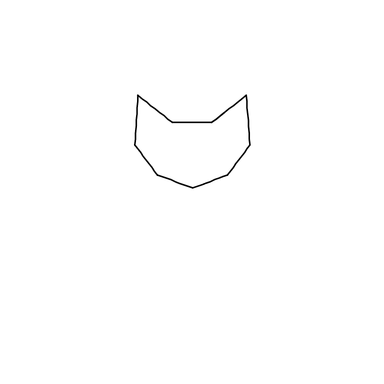
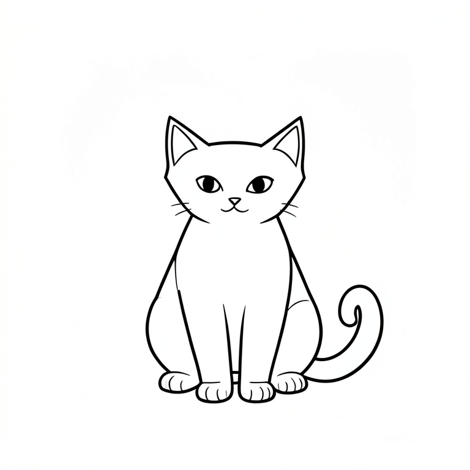

# DrawingLab v0.1

画几笔草图，让本地大模型补全参考；你继续掌握自己的笔迹。

DrawingLab 是本地运行的 Web 绘画助手，提供固定 3px 黑笔、橡皮、撤销/重做、浅色 AI 参考、矢量轻修稿、JSON 保存和 PNG 导出。本次首个公开版本保留原型 V4 的交互与项目格式；`v0.1.0` 是发行版本，API `version: 4` 和项目 `app_version: 4` 是原有协议版本。

## 真实演示

以下图片来自本次实际运行，不是 mock、宣传效果图或界面截图。左图是在浏览器画布用鼠标拖动绘制并点击“导出 PNG”得到的原创猫头；右图是服务端保存的 **Klein 原始生成参考**。参考图尚未被用户采用，因此不能当成“导出 PNG”的结果。

| 原创输入：10 笔猫头轮廓 | 本地 Klein 实际生成的完整参考 |
| --- | --- |
|  |  |

提示词：一只坐着的小猫，保留尖耳朵和脸部轮廓，补全身体、爪子和卷曲尾巴，简单黑色线稿，纯白背景。

2026-10-26，RTX 3060 Laptop GPU，768×768、4 步、seed 42、BF16、CPU offload，首次总耗时 **49.19 秒**，其中加载 20.016 秒、推理 29.062 秒，峰值 GPU 张量分配约 **8.58 GiB**。不是全设备显存，也不是所有设备的性能保证。该样例触发轮廓偏差提示：模型没有精确保留所有轮廓，不能宣称语义或绘画质量已通过验证。

可导入的原稿：[cat-sketch.json](examples/cat-sketch.json)。完整本次指标：[cat-metrics.json](examples/cat-metrics.json)。浏览器截图接口在本次环境超时，所以这里展示未经修饰的真实输入/输出图片，不冒充 UI 截图。

## 快速启动：先用画布

推荐 Windows 10/11、Python **3.11 或 3.12**。基础画布不需要 GPU、模型或 API 密钥。

```powershell
# 在项目目录执行；python 需指向 Python 3.11/3.12
./setup.ps1
./start.ps1
```

若默认 Python 版本不符：`./setup.ps1 -Python 'C:\path\to\Python311\python.exe'`。然后打开 **http://127.0.0.1:8765**。也可双击 `start.cmd`。同一端口只能运行一个实例。

首次 setup 创建项目内 `.venv` 并从 PyPI 安装依赖。缺少模型时会明确显示“尚未就绪”，仍能绘画、整理线条、保存和导出，不会生成假的 AI 结果。没有前端构建步骤；HTML/CSS/JS 由 FastAPI 直接提供。

其他系统可以使用 Python 3.11/3.12 手动创建 venv，然后 `python -m pip install -r requirements.txt -r requirements-test.txt`、`python -m drawinglab.server`；本版未进行 Linux/macOS 实机验收。

## 安装本地 AI 模型

默认 **FLUX.2 klein 4B**。推荐支持 BF16 的 NVIDIA CUDA GPU；本次在 12GB 显存设备验证。模型本身约 **14.883 GiB**，另需 PyTorch、Python 包、缓存和运行内存；建议至少预留 30GB 磁盘空间。CPU offload 也会占用系统内存。CPU 推理可显式选择，但本版未验证性能。

```powershell
./setup.ps1 -WithModels
./start.ps1
```

此命令明确下载 CUDA 12.8 PyTorch、Klein 依赖及模型；需要可访问 PyPI、PyTorch 和 Hugging Face。下载量较大，网络/流量费用由本地网络决定。使用前请阅读模型上游条款。

模型固定到 `e7b7dc27f91deacad38e78976d1f2b499d76a294`。下载脚本支持断点续传，并按清单 SHA-256 校验有哈希的文件；其他小文件核验大小。运行时只加载本地 safetensors，`local_files_only=True`，不调用模型云 API。仓库不附带模型权重。

```powershell
./.venv/Scripts/python.exe scripts/download_klein.py --plan
./.venv/Scripts/python.exe scripts/download_klein.py --verify-only
```

原 CounterfeitXL + anime-painter 后端仍保留：在独立副本/venv 中用 `./setup.ps1 -WithModels -Engine counterfeit` 安装，避免与 Klein 的不同 Diffusers 依赖混装。可选 DoodleAssist 集成代码也保留，但底模与上游许可需另行确认，**未完成完整生成验证，不属于 v0.1 已验收的后端**。

## 使用流程

1. 写下希望绘制的内容。Klein 支持中文；画几笔后自动生成浅参考，也可点击“更新整幅参考”。
2. 保留想要的提示并继续描画；“换一个”变更种子，“固定参考”暂停更新。参考线深浅可调为 3%–20%。
3. “叠加 AI 原始参考图”显示模型完整假设；它包含尚未采用的内容，不进入模型输入、项目笔迹或 PNG 导出。
4. “AI 修稿”生成曲线微调提案；“整理线条”仅做本地几何去抖。可以框选、锁定、调节幅度、对比原稿，点击“应用修稿”才修改作品。整次操作可撤销。
5. “保存项目”将可编辑 JSON 写入 `data/projects`；“导出 PNG”将真实笔迹写入 `data/exports`。AI 浅参考和未应用预览不进入 PNG。完整模型图片另存于 `data/sessions/<session>/candidate.png`，仅作诊断/参考。
6. 打开已有项目，或通过“打开项目 → 导入 JSON”导入示例。`B` 画笔，`E` 橡皮，`S` 选区，`Ctrl+Z` 撤销，`Ctrl+Shift+Z` / `Ctrl+Y` 重做。

未保存笔迹只在当前标签页。关闭、刷新、切换版本前请先保存。模型生成期间可以继续绘画；旧结果不能覆盖新版本，同一会话只保留最新待处理任务，全局只运行一个 GPU worker。

## 配置与数据

见 [.env.example](.env.example)。本项目**不自动加载 `.env`**；示例列出环境变量，在 PowerShell 当前进程设置即可：

```powershell
$env:DRAWINGLAB_ENGINE = 'klein'
$env:DRAWINGLAB_PORT = '8765'
# 可选：复用已有模型目录，里面应有 flux2-klein-4b 子目录
$env:DRAWINGLAB_MODEL_DIR = 'D:\your-models'
./start.ps1
```

默认模型在 `models/`。`DRAWINGLAB_MODEL_DIR` 只改变模型读取路径，缓存、临时文件、日志、用户画稿仍写在本项目。`models/active-engine.json` 可指定后端，环境变量优先；无配置时默认 Klein。没有 API key、云服务账户或付费订阅要求。不要把密钥、个人画稿或环境目录提交到 Git。

服务仅绑定 `127.0.0.1`，为本机单用户使用；没有公网认证、账户隔离或多租户设计，不应直接暴露到公网。

## 验证

```powershell
./.venv/Scripts/python.exe -m pytest tests --basetemp=.tmp/test-release -o cache_dir=.cache/pytest -q
./.venv/Scripts/python.exe -m pip check
node --check static/app.js
```

本次新安装基础环境：**95 项 Python 测试通过**、pip check 通过、JS 语法通过；本机 HTTP 失败恢复/保存/导出另有 6 项检查通过。测试覆盖几何、调度过期结果、输入校验、保存/导出、缺模型、模型异常恢复、修稿与锁定等；测试中的替身明确不代表模型画质。真实 GPU 模型演示独立记录在上方。完整发布检查记录见 [docs/VALIDATION.md](docs/VALIDATION.md)。

保留的浏览器回归脚本使用 Playwright：`npm install` 后启动应用，再执行 `npm run test:browser`。V3 传输测试使用标记的 PNG 夹具，不是模型质量验收；旧协议、依赖私人旧画稿的开发诊断脚本不在发布包中，原开发目录保留它们。

## 边界与许可

- 当前是停笔后更新，不是逐笔实时生成；速度受 GPU、内存、画面和模型加载影响。
- 生成栅格参考会偏离原有轮廓；统计风格提示不等于已训练的个人风格模型，不能保证解剖、手指或局部语义正确。
- 轻修稿保留笔画拓扑的启发式限制，最多处理 256 个适用笔画、每笔 2500 点；复杂图可能部分保留原样。没有自动把全部 AI 黑线采用为用户笔迹。
- 本次真实 GPU 验证复用既有的模型与 GPU 依赖；全新基础安装已验证，完整 15GB 模型重新下载和全新 GPU 环境安装未重复执行。
- 原项目未提供软件许可证。本发布**不擅自授予额外开源许可**；公开可读不代表获得任意复制、修改、商用或再分发授权。第三方模型与库按各自许可使用，详见 [THIRD_PARTY_NOTICES.md](THIRD_PARTY_NOTICES.md)。
